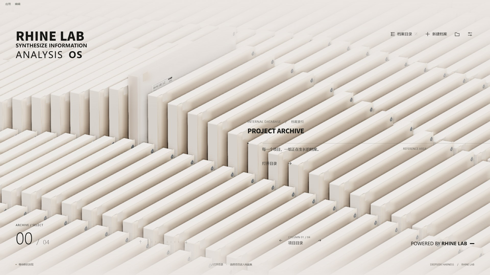

# RHINE Observatory · DSH 主题

把莱茵生命的三维档案室，带入真实的 AI 工作区。

适用于 **Windows · DeepSeek Harness Desktop 0.2.0-rc.2**。项目档案、会话编辑器与主题设置连接 DSH 实际数据，提供浅深色外观、专注阅读与可选开场动画。

[下载 1.0.1](https://github.com/PacificSauryMan/RhineLabUI/releases/tag/dsh-rhine-v1.0.1) · [安装与卸载](integrations/dsh-rhine-theme/distribution/INSTALL.md) · [主题源码与开发说明](integrations/dsh-rhine-theme/README.md) · [反馈问题](https://github.com/PacificSauryMan/RhineLabUI/issues)



*来自主题实际运行的档案首页截图；画质、显示比例与项目数量会影响最终呈现。*

## 主题体验

- **三维项目档案**：档案阵列接入真实项目，进入会话后保留工作区导航与编辑器。
- **专注阅读**：连续展开与收起，光学组件可旋转、拆解；草稿、附件和发送由宿主服务处理。
- **外观与声音**：浅深色、中文与英文、开场开关与 Esc 跳过，可选环境声默认关闭。
- **性能设置**：画质与最高帧率可调，默认上限 60 FPS；90 FPS 是可选上限，实际表现取决于设备。支持减少动态效果。
- **Windows 窗口适配**：另附可选工具，提供窗口按钮、F11、标题栏配色与退出全屏居中，包含版本检查、备份及卸载。

## 下载与安装

1. 从 [Release](https://github.com/PacificSauryMan/RhineLabUI/releases/tag/dsh-rhine-v1.0.1) 下载 `dsh-rhine-theme-1.0.1-windows.zip`，解压到固定目录。
2. 在 DSH 的 **插件 → 添加插件** 中输入其中 `.tgz` 文件的绝对路径，安装并启用 RHINE。停用其他接管整个界面的主题。
3. 从菜单或系统托盘完整退出 DSH，再重新启动。只关闭窗口可能仍在后台运行。

```text
C:\Tools\RHINE-1.0.1\dsh-rhine-theme-1.0.1.tgz
```

普通主题安装无需 Node.js 或编译工具，首次解析依赖需要网络。不要把 ZIP 路径填入插件管理器，也不要覆盖自己的 profile。

完整窗口效果需要额外安装原生适配；该工具会修改 DSH 应用文件，要求 **Node.js 22.12+** 和已退出的 DSH。具体命令、ASAR 支持、更新及恢复步骤见 [安装说明](integrations/dsh-rhine-theme/distribution/INSTALL.md)。只需要主题时可以跳过。

已有用户若遇到全屏和 70% 最小面积限制同时失效，请下载新版完整 ZIP，使用其中原生工具的 `check` 检查，再按提示运行 `install` 并重启 DSH。新版能识别“主题仍显示，但主进程入口已经丢失”的不完整安装；仅重装主题 `.tgz` 无法修复该入口。

| 下载文件 | 用途 |
| --- | --- |
| `dsh-rhine-theme-1.0.1-windows.zip` | 完整包：预构建主题、可选原生工具、安装说明和许可 |
| `dsh-rhine-theme-1.0.1.tgz` | 仅主题插件，可直接由 DSH 安装 |
| `SHA256SUMS.txt` | 发布文件的 SHA-256 校验值 |

目前只验证了 Windows Desktop **0.2.0-rc.2**；其他宿主版本与 macOS/Linux 未验证。原生工具会拒绝不支持的版本，DSH 升级后需重新确认兼容性。

## 从源码构建

```sh
git clone --branch dsh-rhine-theme --single-branch https://github.com/PacificSauryMan/RhineLabUI.git
cd RhineLabUI/integrations/dsh-rhine-theme
npm ci
npm test
npm run build
```

需要 Node.js 22.12+。主题在 `integrations/dsh-rhine-theme` 中独立构建，输出到 `lib/`；不需要构建仓库根目录的网页项目。Windows 用户运行 `npm run release` 可生成发布包，再执行：

```sh
node scripts/verify-release.mjs releases/1.0.1/dsh-rhine-theme-1.0.1-windows.zip
```

类型检查需要匹配版本的 DSH 声明文件，配置方法见 [开发说明](integrations/dsh-rhine-theme/README.md#与真实宿主检查)。[CI](https://github.com/PacificSauryMan/RhineLabUI/actions/workflows/dsh-theme.yml) 运行测试、构建和独立发布包校验。

## 来源与许可

本分支是 [LBEILC / RhineLabUI](https://github.com/LBEILC/RhineLabUI) 的 DSH 衍生主题。原始视觉、三维模型、场景、动效及原创环境声来自上游；DSH 适配、性能优化与发布工具由贡献者和 OpenAI Codex 协作完成。

主题与上游代码采用 MIT 许可，保留原作者署名。字体等资源遵循各自许可，见 [主题 LICENSE](integrations/dsh-rhine-theme/LICENSE)、[第三方声明](integrations/dsh-rhine-theme/THIRD_PARTY_NOTICES.md) 与 [许可文件](integrations/dsh-rhine-theme/licenses)。本项目是《明日方舟》莱茵生命视觉世界的非官方同人作品，与鹰角网络、DeepSeek 及其他权利人无隶属或背书关系。

此分支维护 DSH 主题；网页项目的原始介绍保留在 [README.upstream.md](README.upstream.md)，可通过 [上游在线演示](https://rhine.lubeiluchen.cc/) 体验原始网页作品。

## 参与与交流

欢迎提交可复现的问题与改进建议。请先阅读 [贡献指南](CONTRIBUTING.md)、[行为准则](CODE_OF_CONDUCT.md) 和 [安全说明](SECURITY.md)。DSH 主题问题请提交到本仓库，避免把适配问题转交给上游作者。

友情链接：[LINUX DO](https://linux.do/) · 技术交流社区。
